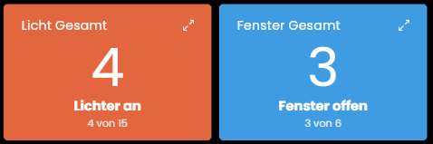
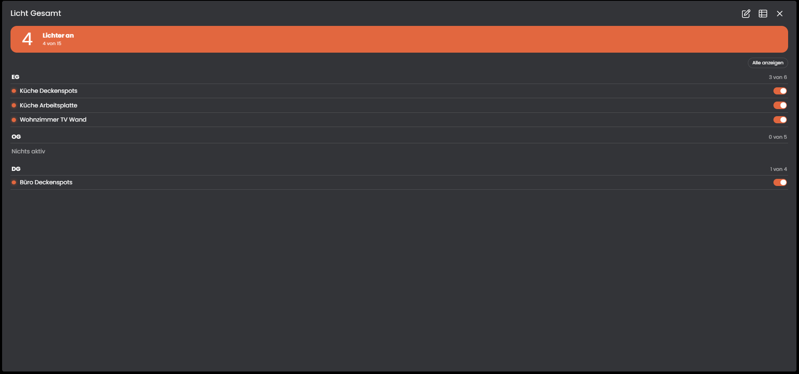

# Zustandszaehler
Mit diesem Modul lässt sich zählen, wie viele Lichter an oder Fenster offen sind, getrennt nach Etagen oder anderen Gruppen. Eine Liste in der Instanz ersetzt Ereignisse und Zählskripte.

## Inhaltsverzeichnis
- [Zustandszaehler](#zustandszaehler)
  - [Inhaltsverzeichnis](#inhaltsverzeichnis)
  - [Screenshots](#screenshots)
  - [1. Voraussetzungen](#1-voraussetzungen)
  - [2. Funktionsumfang](#2-funktionsumfang)
  - [3. Enthaltene Module](#3-enthaltene-module)
  - [4. Installation](#4-installation)
  - [5. Konfiguration in IP-Symcon](#5-konfiguration-in-ip-symcon)
  - [6. Spenden](#6-spenden)
  - [7. Lizenz](#7-lizenz)

## Screenshots

## 1. Voraussetzungen

* mindestens IPS Version 9.0

## 2. Funktionsumfang

* Zählt aktive Variablen (Licht an, Fenster offen oder eigene Zustände) gesamt und je Gruppe
* Neue Lichter oder Fenster kommen als Zeile in die Liste, ohne Ereignisse oder Skripte
* Kachel je Instanz (zum Beispiel je Etage) mit der Anzahl und, maximiert, der Liste der betroffenen Variablen
* Variablen für Gesamtzahl, Gruppen und eine Übersicht als Text zur Weiterverarbeitung

Die einzelnen Funktionen stehen bei den Instanzen unter "Enthaltene Module" und in der README des jeweiligen Moduls.

## 3. Enthaltene Module

* [Zustandszähler](Zustandszaehler/README.md)
  * Zählt aktive Variablen gesamt und je Gruppe und zeigt sie in einer Kachel.

## 4. Installation

Die Installation erfolgt über den IP-Symcon Module Store.

## 5. Konfiguration in IP-Symcon
Eine Instanz Zustandszähler anlegen und die Variablen mit Gruppe und Name in die Liste eintragen. Details stehen in der [README des Moduls](Zustandszaehler/README.md).

## 6. Spenden

Dieses Modul ist für die nicht kommerzielle Nutzung kostenlos, Schenkungen als Unterstützung für den Autor werden hier akzeptiert:

 

## 7. Lizenz

[CC BY-NC-SA 4.0](https://creativecommons.org/licenses/by-nc-sa/4.0/)
